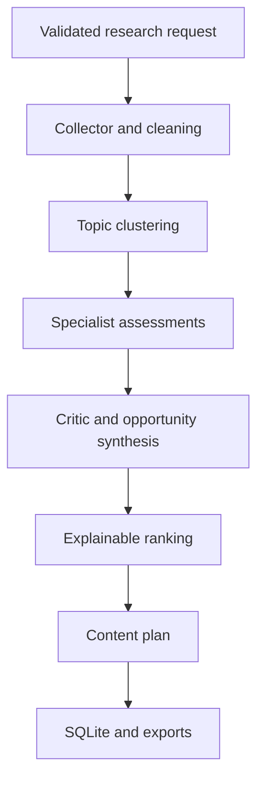

# Architecture and scoring

## Request lifecycle

1. FastAPI validates the research request and checks the optional access token.
2. A single-run gate bounds concurrent work. Live mode also checks the process-local daily run budget.
3. The collector retrieves public video IDs and metadata, or builds synthetic demo records.
4. Cleaning deduplicates IDs, validates timestamps and preserves missing numeric observations.
5. TopicClusteringAgent builds unigram/bigram TF-IDF vectors and groups them with average-linkage cosine-distance clustering. An empty vocabulary falls back to one low-relevance group. A zero-feature document is supported by a precomputed distance matrix.
6. Each cluster is assessed by separate trend, competitor and engagement agents. OpportunityAgent gathers their structured outputs and asks CriticAgent to challenge the evidence.
7. RankingEngine normalises signals and records exact weighted contributions.
8. StrategyGenerator creates an editable plan. Optional model drafting can change only creative fields, never scores or source evidence.
9. A transaction saves the result and live view observations. The interface displays results and offers exports.



The agents are independent Python components with explicit inputs and outputs. They run in sequence within one research job; this release does not claim concurrent execution or autonomous conversational debate. Scikit-learn provides unsupervised machine learning for clustering. Language-model usage is optional and limited to drafting.

## Signal definitions

| Signal | Raw value | Base weight |
| --- | --- | ---: |
| Demand | Median of current views / max(video age in days, 1), using known view counts | 0.22 |
| Momentum | Median views gained per day since a prior observation, at least one hour and at most 30 days earlier | 0.15 |
| Competition | Number of distinct channels within the topic cluster | 0.12 |
| Engagement | Median (likes + comments) / views for positive views and complete engagement counts | 0.14 |
| Freshness | Mean max(0, 1 − video age in days / requested window) | 0.12 |
| Relevance | Mean cosine similarity between the niche query and topic documents | 0.15 |
| Content gap | Fraction of documents without explicit example/demo/case-study/walkthrough/hands-on wording | 0.10 |

Demand is a view-pace proxy, not search volume. Momentum is incremental view pace, not a change in pace. Counter decreases are ignored for momentum because they may reflect corrections rather than negative demand. Competition excludes all unretrieved channels. The content-gap feature is intentionally a weak textual heuristic; it does not establish that an unmet need exists.

For demand, momentum, competition and engagement, transform raw values with `log1p(max(0, value))`, then min-max scale across this run's clusters. Equal values receive 0.5. Invert the competition value so fewer sampled competitors yield more points. Freshness, relevance and content gap are already in [0, 1].

A signal missing for **any** candidate is removed from the entire ranking cohort. Rescale the remaining base weights to sum to one. This avoids awarding some candidates different scoring bases. All raw observations remain visible even when a signal is omitted.

`score = 100 × sum(normalised_signal × effective_weight)`

Scores are rounded to two decimal places for display, but contributions retain precision. They are comparable only inside one run, not across niches or dates. The weights and clustering threshold are engineering defaults; no benchmark or outcome-based calibration is claimed.

## Critic and decision policy

The critic flags:

- Fewer than three videos or three independent channels.
- A video responsible for over 60% of a topic's sampled views.
- A channel responsible for over 60% of the topic's videos.
- Fewer than three comparable historical view observations.
- Incomplete engagement observations.

A candidate is marked `review` when there are fewer than three videos, fewer than two channels, or a single-video view share above 60%. Otherwise it is `supported_in_sample`. The weaker three-channel threshold remains an advisory warning. Historical insufficiency also remains visible even if current cross-sectional support is adequate.

Evidence strength is `limited` for review candidates and `moderate` otherwise. It is not a calibrated statistical confidence level or success probability. Scores are not silently penalised by the critic: the independent status and warnings remain visible. Reviewed candidates receive `Review first` priority; supported candidates in the top three receive `High`, and other supported candidates receive `Normal`.

## Storage

`runs(id, created_at, payload)` stores complete JSON output. `observations(video_id, observed_at, views)` stores live view snapshots keyed by video and observation time. SQL uses bound parameters. Synthetic records never enter the observation table. Only successfully completed research is saved.

Prior observations use the same video ID, with a time separation between one hour and 30 days. The latest eligible observation is chosen. The history endpoint shows the most recent 50 saved runs. Cleanup on data access/save removes records older than 30 days; there is no idle background scheduler.

## API

All `/api` routes except `/api/config` require `Authorization: Bearer TOKEN` when `APP_ACCESS_TOKEN` is configured.

| Method | Path | Purpose |
| --- | --- | --- |
| GET | `/health` | Liveness |
| GET | `/api/config` | Credential availability flags only |
| POST | `/api/research` | Create and save a research run |
| GET | `/api/runs` | Recent saved runs |
| GET | `/api/runs/{id}` | Full result |
| GET | `/api/runs/{id}/export/json` | Full evidence and plan |
| GET | `/api/runs/{id}/export/csv` | Ranking table |
| GET | `/api/runs/{id}/export/md` | Readable plan and evidence appendix |
| DELETE | `/api/runs` | Delete all runs and observations |

Example request:

```json
{"niche":"AI coding tools","audience":"Beginner developers","format":"Tutorial","mode":"demo","days":30,"max_videos":30}
```

The frontend inserts provider/user text using `textContent`. Live evidence links are constructed only from validated 11-character YouTube IDs. CSV cells beginning with spreadsheet formula markers are escaped. The app uses same-origin requests and does not enable cross-origin API access.

## Deliberately not claimed

No real-world success rate, calibrated confidence, semantic embedding model, autonomous LLM debate, full-channel inventory, comment-text sentiment analysis, scheduled monitoring, private analytics, trained ranking model, RAG/vector database, multi-user isolation or actual external deployment is represented as implemented. These are possible extensions, not hidden dependencies needed to run the current application.
